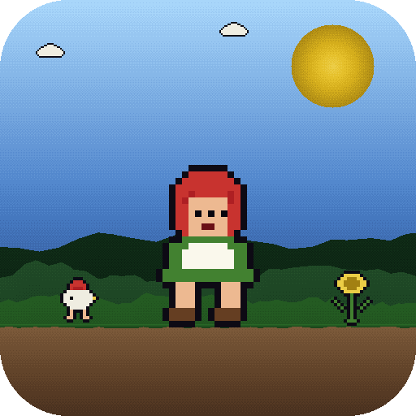
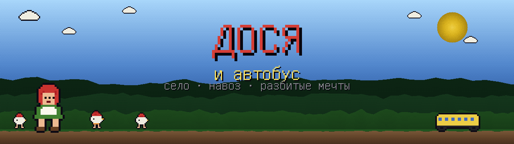

# ДОСЯ и автобус

[](https://github.com/DartPower/dosya/actions/workflows/ci.yml)
[](https://github.com/DartPower/dosya/releases)
[](LICENSE)


Платформер для настоящего DOS. 320×200×256, Mode 13h, DJGPP, PC speaker.
Написан с нуля, но с большим уважением к DOOM и Supercow.



```
Дося жила в селе Тихое Говно.
Раз в сутки там шёл автобус.
Дося всегда на него опаздывала.
Сегодня она вышла заранее.
Автобус вышел ещё раньше.
```

## Скачать и играть

Возьмите `dosya-vX.Y.Z.zip` из [релизов](https://github.com/DartPower/dosya/releases),
распакуйте, запустите `DOSYA.EXE` в DOSBox:

```ini
mount c <папка>
c:
DOSYA.EXE
```

`CWSDPMI.EXE` должен лежать рядом — без него DOS не умеет 32-битный
protected mode.

### Управление

| Клавиша | Действие |
|---|---|
| Стрелки / A, D | идти |
| Пробел | прыжок (держите дольше — прыжок выше) |
| Z / X / Ctrl | кинуть навоз |
| P | пауза |
| Esc | выход |

## Что внутри

Три уровня: **ОГОРОД → ДЕРЕВНЯ → ТРАКТОРНОЕ ПОЛЕ**. Дося бежит к автобусу,
прыгает через ямы, давит кур, кидает навоз в дедов и коз, собирает молоко,
яйца и самогон.

Смерть всегда объясняется: утонула, упала, наступила на грабли, «куры
победили». Финал честный:

> Автобус довёз её до города.
> В городе её сбил трамвай.
> Но это уже другая история.

### Механики

* **Переменная высота прыжка** — держите пробел, летите выше.
* **Coyote time** — 6 кадров после схода с края прыжок ещё работает.
* **Стомп** — прыжок на голову врагу. Дед выдерживает два.
* **Навоз** — метательное оружие. 3 штуки с каждого поднятого.
* **Самогон** — ускорение и неуязвимость на 7 секунд.
* **Трактор** — не давится. Трактор не тормозит. Никогда.

## Собрать самому

Нужен Python 3 и Pillow. Всё остальное скачивается скриптом.

```powershell
python -m pip install pillow
python tools\setup.py         # DJGPP + CWSDPMI + шрифт
python tools\build.py dos     # -> dist\DOSYA.EXE
```

Подробности: [docs/building.md](docs/building.md).

## Как это устроено

Никаких библиотек кроме libc DJGPP. Пять файлов, ~2200 строк C.

| файл | что делает |
|---|---|
| `video.c` | Mode 13h, PIT 1 кГц, IRQ1. Два бэкенда: DOS и host для отладки без DOSBox |
| `render.c` | спрайты, тайлы, шрифт, градиенты в один 8-битный буфер |
| `game.c` | физика 8.8 fixed point, враги, камера, HUD, автомат состояний |
| `sound.c` | квадратные волны через PC speaker |
| `main.c` | цикл с фиксированным шагом 60 Гц |

**Ноль бинарных ассетов.** Спрайты — ASCII-сетки, тайлы — процедурный шум,
шрифт — GNU Unifont в CP866, уровни — текстовые сетки. Всё генерируется из
Python в `build/gen/`.

Подробно: [docs/architecture.md](docs/architecture.md) ·
[docs/assets.md](docs/assets.md) · [docs/levels.md](docs/levels.md)

## Тесты

```powershell
python tools\build.py host
python tools\smoke.py
```

Автопилот пробегает все три уровня, тест проверяет, что игра проходима и
никто не умер насмерть. Это же гоняет CI на каждый пуш.

Плюс `DOSYA.EXE -test 400` рендерит 400 кадров в PPM — так проверяется
настоящая DOS-сборка без клавиатуры.

## Честные предупреждения

* Звук — PC speaker. Никакого Sound Blaster нет и не планируется.
* Палитра собрана из рампов, поэтому градиент по индексам даёт радугу.
  Все градиенты задаются парой (рамп, шаг).
* Уровни 120/140/160 тайлов в длину — примерно 3 минуты на уровень, или
  40 секунд, если умереть на первом тракторе.

## Лицензия

MIT. Делайте что хотите, только не говорите, что это ваша Дося.

Хотите помочь — [CONTRIBUTING.md](CONTRIBUTING.md).

---

<sub>Иконка и баннер тоже генерируются: `python tools/gen_icon.py`.</sub>
